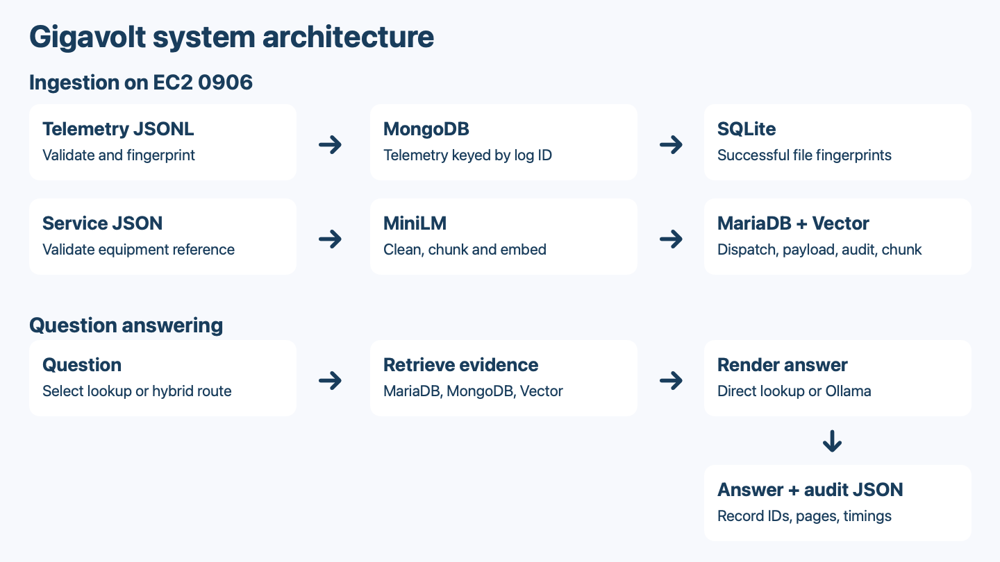

# Project Gigavolt

An AWS-based data lakehouse and retrieval-augmented generation (RAG) application for industrial battery support. A field engineer can ask about a unit's service history, recent telemetry, or a manual specification and trace the answer to the underlying record or passage.

**ISTM 622 semester project · Harshil Prashant Shah**

## What the system does

- **Ingests and validates data.** SQL transforms raw ERP records into normalized tables. Incremental loaders fingerprint service and telemetry inputs so unchanged files can be skipped.
- **Retrieves evidence across stores.** MariaDB serves relational records, MongoDB serves nested telemetry, and MariaDB Vector searches MiniLM document embeddings.
- **Returns traceable answers.** Structured routes render saved records directly. Ollama summarizes selected technical passages. Responses retain source identifiers for review.



## Results at a glance

On the same 22-prompt EC2 workload, all-request P95 improved from **7.547 s to 4.976 s** and sequential throughput rose from **0.363 to 0.780 requests/s**. The six final answers that called Ollama had a **4.531 s end-to-end median**. The final citation audit resolved **25 of 25 emitted references** to saved evidence.

[See benchmark scope, measurements, and reproduction commands](#benchmark-and-provenance).

## Milestones

| Milestone | Implementation |
|---|---|
| 1 | [MariaDB lakehouse ingestion and data quality checks](01-lakehouse/load_and_validate.sql) |
| 2 | [Generated service context, RAG stored procedure, audit triggers and views](02-sql-automation/) |
| 3 | [Galera configuration, recovery scripts and InnoDB versus ColumnStore benchmark](03-galera-columnstore/) |
| 4 | [Document chunking, MiniLM embeddings and MariaDB Vector retrieval](Gigavolt_M4_Existing_Instance/) |
| 5 | [Hybrid SQL, MongoDB, vector and Ollama query application](gigavolt-m5/) |
| 6 | [Incremental loaders, verified lookup routes and benchmarks](gigavolt-m6/) |

## Verify locally

The chunking and cleaning tests run without access to the lab database or model servers.

```bash
python3 -m unittest discover -s Gigavolt_M4_Existing_Instance/src -p test_windows.py
```

## Lab setup

Use a disposable lab environment with MariaDB Vector, MongoDB, and a running Ollama service for the query application. The SQL tools use the local MariaDB client through sudo as in the original lab. Milestone 3 requires separate Galera nodes and a ColumnStore-enabled benchmark node. Its cluster configuration contains placeholders for the three addresses. Review the cluster scripts against the actual node state before using them.

1. Obtain the authorized ERP CSV inputs, technical manual archive, and telemetry dataset from their original source. Raw inputs, database dumps and local credentials are excluded. The two files under `gigavolt-m6/examples` are synthetic fixtures.
2. Create a fresh MariaDB schema named `gigavolt`. Use the Milestone 1 script with the five CSVs in MariaDB's configured import directory. The script contains table drops from the original lab workflow and is intended for a disposable schema. Apply the numbered Milestone 2 scripts in order in that schema.
3. Follow the [Milestone 4 runbook](Gigavolt_M4_Existing_Instance/README.md) for the database account and corpus setup. Use the checked-in folder as the project root. The hybrid application expects the Milestone 4 run artifacts at `Gigavolt_M4_Existing_Instance/runs/run01` and the local connection configuration at `Gigavolt_M4_Existing_Instance/config/db.json`.
4. Install the Python dependencies in a virtual environment. Copy `.env.example` to `.env`, set the MongoDB and Ollama endpoints if they run remotely, and set `GIGAVOLT_VECTOR_TABLE` to the schema-qualified M16 table listed in `runs/run01/tables.json`. Load `qwen2.5:1.5b` on the Ollama host.

```bash
python3 -m venv .venv
source .venv/bin/activate
python -m pip install -r requirements.txt
cp .env.example .env
# Edit .env for your deployment, then load it.
source .env
```

5. Import approved telemetry as needed into `gigavolt_m5.telemetry` and create the unique `log_id` index. Check that `EQ-5002` exists in MariaDB before loading the service fixture, or set its equipment ID to a valid unit in your environment. Keep the fixed demo dispatch ID.

```bash
mongosh "$GIGAVOLT_MONGO_URI" --eval   'db.getSiblingDB("gigavolt_m5").telemetry.createIndex({log_id:1},{unique:true})'
mkdir -p gigavolt-m6/inbox gigavolt-m5/results gigavolt-m6/results
cp gigavolt-m6/examples/telemetry-demo.jsonl gigavolt-m6/examples/service-demo.json gigavolt-m6/inbox/
python gigavolt-m6/run_pipeline.py
python gigavolt-m6/run_pipeline.py
python gigavolt-m6/ask_m6.py "What is the latest telemetry status for SN-M6-0001?"
python gigavolt-m6/ask_m6.py "What does the G-3500 technical documentation say about voltage limits?"
```

The first run validates and loads the fixtures. A repeat uses the telemetry file fingerprint and verifies the service dispatch, payload, vector and audit counts. The voltage question requires the corresponding manual in the vector corpus.

## Course inputs and validation

Use the instructor-provided files from the Advanced Data Management course. These are the raw input counts observed before MariaDB cleansing and deduplication.

| Input | Observed source count |
|---|---:|
| `customers.csv` | 525 records |
| `equipment.csv` | 2,575 records |
| `parts.csv` | 150 records |
| `dispatches.csv` | 5,000 records |
| `warranty_claims.csv` | 1,248 records |
| `UnstructuredData.zip` | 25 PDFs, 54 pages, 53 text-bearing pages |

The five CSVs had consistent field counts within each file. The Milestone 4 extractor processed the supplied archive and recorded the known blank page. These checks verify the source files and document extraction. Run the lab acceptance tasks after loading the data to verify the deployed database and application.

## Benchmark and provenance

The original EC2 comparison used the same 22 sequential prompts in both runs. The final run returned 19 answers and three insufficient-evidence responses with zero execution errors.

| Measure | Baseline | Final |
|---|---:|---:|
| All-request P50 | 0.800 s | 0.058 s |
| All-request P95 | 7.547 s | 4.976 s |
| All-request P99 | 10.969 s | 5.564 s |
| Sequential throughput | 0.363 requests/s | 0.780 requests/s |

The six final Ollama-backed answers had an end-to-end median of **4.531 s**. The mixed workload contains direct lookups and model-backed requests. Timings exclude startup and warm-up. The [saved summary](docs/benchmark-summary.json) and [citation audit](docs/citation-audit.txt) contain the observed results. The audit resolved 25 of 25 emitted references to saved records, and separate relevance review found remaining answer-quality gaps.

To run the two benchmark modes against your prepared environment:

```bash
python -u gigavolt-m6/benchmark_m6.py baseline
python -u gigavolt-m6/benchmark_final80.py
```

The historical benchmarks include prompts targeting the original course data and synthetic recovery records. Fresh runs can differ with different inputs, models, or hardware.

## Live verification on EC2

On November 15, 2026, commit `cf680a2` passed the lab acceptance check in a separate checkout on the existing AWS deployment. The check used the deployed MariaDB Vector, MongoDB, Ollama model, and original lab inputs.

| Check | Verified result |
|---|---|
| Telemetry lookup | The live answer reported `STANDBY` and 31.0 °C, matching MongoDB record `TLM-M6-DEMO-001`. |
| Service ingestion evidence | The demo dispatch had one stored dispatch, one RAG payload, indexed vector content, and one insert audit entry. |
| G-3500 manual lookup | The answer returned 750 V nominal and a 620–860 V DC operating range, citing page 1 of the model manual. |
| X-7000 hybrid answer | The Ollama statement matched page 1 of engineering change order `GV-ECO-2024-019`: DSP firmware v2.4.11-b or later, with commutation dead-time changing from 2.2 to 2.8 µs. |

All six Milestone 4 text-processing tests also passed locally. The live acceptance check passed both from the EC2 command line and from **Gigavolt: Verify live answers** in VS Code over Remote SSH. The VS Code run loaded the repository-local environment settings and passed all four checks. The X-7000 passage comparison above was performed on the earlier command-line answer. A fresh infrastructure deployment and a new 22-prompt benchmark were outside this verification.

## Run and verify from VS Code

Open the project root in VS Code on the Linux machine hosting the lab, or use VS Code Remote SSH to open that folder on EC2. Create the repository-local `.venv`, load the course data, stage the two demo fixtures, and configure `.env` using the setup steps above. Use a dedicated lab and keep the fixed service demo dispatch ID. If the original lab already contains these records, keep the original staged fixture files. Changing the fixture under an existing log or dispatch ID creates a conflict by design.

Use **Tasks: Run Task** in the Command Palette and run these tasks in order.

| Task | What to look for |
|---|---|
| **Gigavolt: Check lab prerequisites** | MariaDB tables and an existing equipment reference, the indexed manual corpus, MongoDB telemetry with a unique log ID index, and a reachable Ollama model. |
| **Gigavolt: Run incremental pipeline** | Both stages succeed. On a repeat, the same inputs skip processing after the prior writes are verified. |
| **Gigavolt: Verify live answers** | The telemetry answer matches the stored MongoDB event and its citation. The service dispatch has a corresponding payload, vector chunk and audit entry. The G-3500 manual route returns its documented voltage range, and the X-7000 hybrid route returns a cited Ollama statement for review. |

The terminal equivalents, from the repository root, are:

```bash
source .env
.venv/bin/python gigavolt-m6/check_lab.py
.venv/bin/python -u gigavolt-m6/run_pipeline.py
.venv/bin/python -u gigavolt-m6/run_pipeline.py
.venv/bin/python gigavolt-m6/check_lab.py --answers
```

The acceptance check uses the original Gigavolt corpus for the manual and firmware questions. It checks exact results for the synthetic telemetry and G-3500 specification. The Ollama-backed check confirms the route executed and produced a citation. Its generated statement still needs human comparison with the cited passage.
